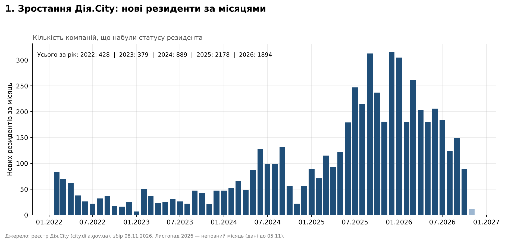
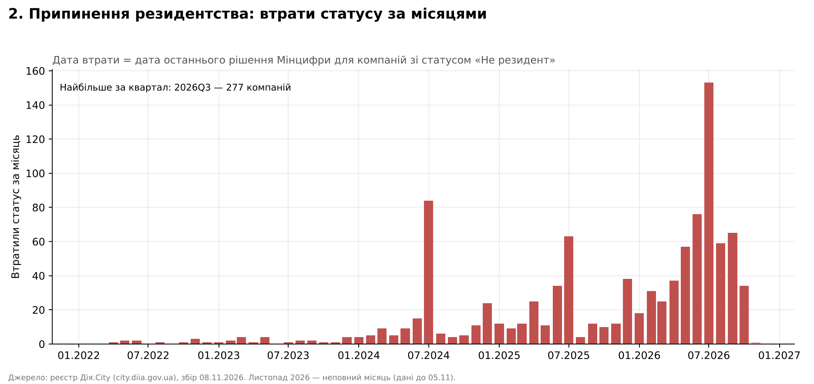
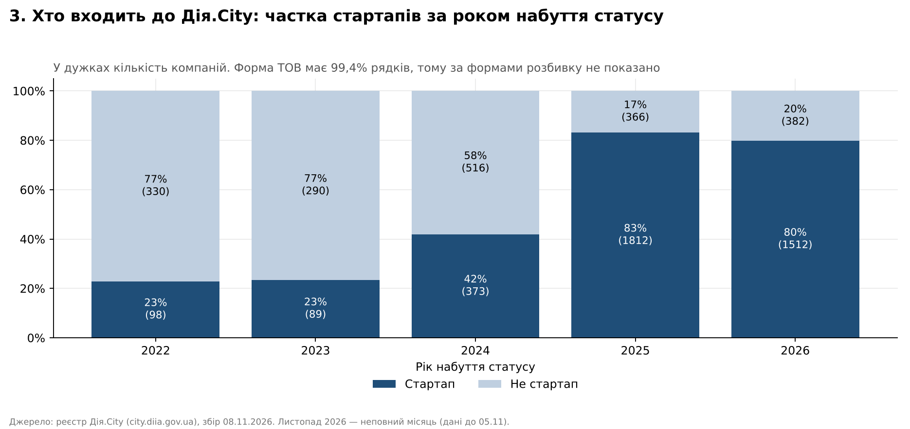
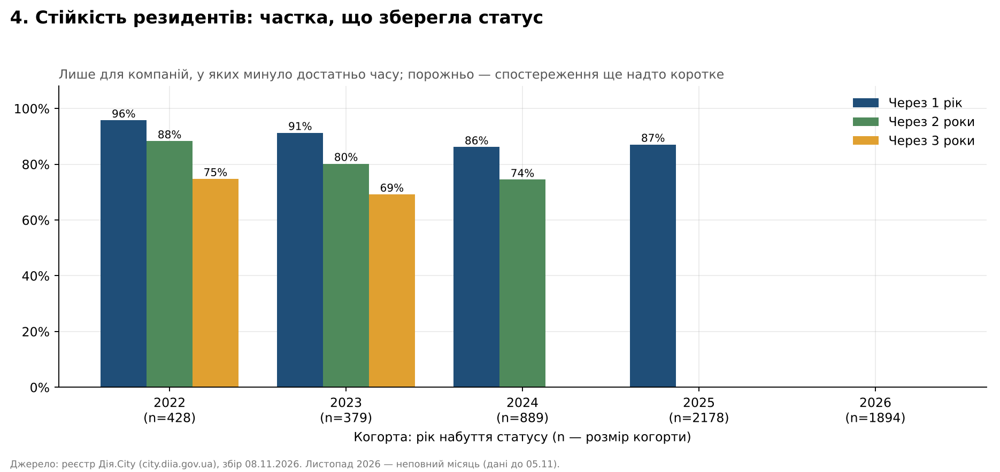
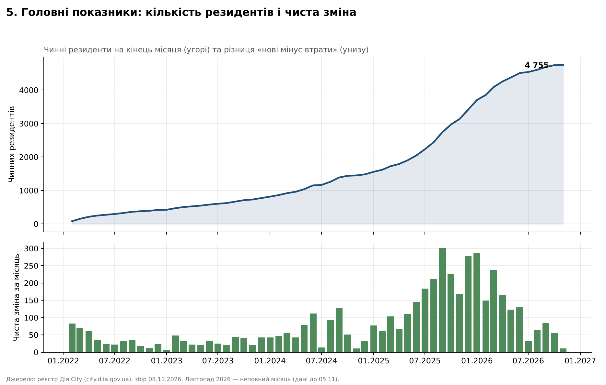

# Дія.City та трансформація зайнятості в ІТ-секторі України: динаміка розвитку спеціального правового режиму у 2022-2026 роках

**Інструменти:** Python і Google Colab (збір і підготовка даних), Excel, Tableau
**Джерело даних:** відкритий реєстр резидентів Дія.City — <https://city.diia.gov.ua/registry/resident>
**Дані зібрано:** 08.11.2026

## Вступ

Розвиток цифрової економіки змінює традиційні підходи до організації праці. В ІТ-секторі дедалі більшого поширення набувають гнучкі моделі зайнятості, дистанційна робота та альтернативні форми співпраці між компаніями й фахівцями.

Одним із кроків України у цьому напрямі стало запровадження спеціального правового режиму Дія.City, який офіційно розпочав роботу 8 лютого 2022 року.

Особливістю режиму є, зокрема, можливість залучення спеціалістів через гіг-контракти, що створює додаткові інструменти організації трудових відносин в ІТ-бізнесі.

Як змінювався Дія.City від моменту запуску, наскільки активно компанії долучалися до режиму та які тенденції можна простежити за роки його існування? Розглянемо це на основі відкритих даних офіційного реєстру резидентів.

## Дані та методика

- Зібрано весь реєстр: **5 768 записів**, які відповідають **5 735 унікальним кодам ЄДРПОУ**. З них **4 755** чинних резидентів і **1 013** записів зі статусом «Не резидент».
- Для кожної компанії збережено ЄДРПОУ, назву, організаційно-правову форму, дату набуття статусу, відмітку про стартап і всі рішення Мінцифри (номер, дата, посилання). Збір виконано автоматично зі сторінок реєстру (Python, Google Colab).
- На сайті немає окремої колонки з датою втрати статусу, там лише позначка «Резидент» або «Не резидент». Для компаній зі статусом «Не резидент» **дата втрати статусу = дата останнього рішення** зі списку рішень Мінцифри.
- Дата останнього рішення не перевірялася за текстом кожного документа. Для публікацій на її основі варто вибірково звірити окремі випадки з PDF-рішеннями.
- 33 компанії мають по два записи: вони втратили статус і набули його знову. Кожен запис тут розглядається як окремий **епізод резидентства**. Тому нові резиденти й втрати на графіках 1, 2 і 5 рахуються за епізодами, а не за унікальними компаніями.
- Листопад 2026 року неповний (найпізніша дата набуття в даних 05.11.2026), на графіках він виділений світлішим кольором.

## 1. Динаміка розвитку Дія.City

### Графік 1. Нові резиденти за місяцями



Графік демонструє, скільки компаній щомісяця набували статусу резидента Дія.City. Це дає змогу оцінити темпи розширення спеціального правового режиму та визначити періоди найбільш активного залучення бізнесу.

До середини 2024 року приплив був невеликим: у 2022 році статус набули 428 компаній, у 2023 році 379. У 2024 році таких компаній було 889, у 2025 році 2 178, а за неповний 2026 рік 1 894. Найбільше набуттів зафіксовано в грудні 2025 року (316), вересні 2025 року (313) і січні 2026 року (305). З початку 2026 року місячні показники нижчі за піки кінця 2025 року.

### Графік 2. Втрати статусу за місяцями



Порівняння з графіком 1 дозволяє оцінити не лише темпи зростання режиму, а й стабільність участі бізнесу.

Кількість компаній, які втратили статус, за роками: 11 у 2022, 23 у 2023, 181 у 2024, 242 у 2025 та 556 у 2026 році (до 05.11). Найбільший місячний показник у липні 2026 року (153 компанії), далі липень 2024 року (84) і червень 2026 року (76). За кварталами максимум припадає на 3 квартал 2026 року (277). Дані реєстру не пояснюють причин втрати статусу, тому цей аналіз є описовим.

## 2. Структура резидентів Дія.City

### Графік 3. Частка стартапів за роком набуття статусу



Відмітка про стартап показує, що склад компаній, які долучаються до режиму, суттєво змінився. Серед компаній, що набули статус у 2022 і 2023 роках, стартапи становили приблизно 23%, у 2024 році 42%, а у 2025 і 2026 роках 83% і 80%. Загалом стартапи становлять 67% усіх записів реєстру (3 884 з 5 768).

**Організаційно-правові форми.** Майже всі записи (99,4%) належать до форми ТОВ, решта форм (приватні підприємства, акціонерні товариства та інші) нечисленні. Тому окремий графік за організаційно-правовими формами не збудовано: він не додав би інформації. Дані про розподіл за видами діяльності в реєстрі відсутні.

## 3. Стійкість резидентів

### Графік 4. Частка компаній, що зберегли статус через 1, 2 і 3 роки



Графік показує, яка частка компаній кожної когорти (за роком набуття статусу) зберігає статус через рік, два й три роки. У розрахунок включено лише компанії, у яких після набуття статусу минув відповідний строк.

Для когорти 2022 року ці частки становлять 96%, 88% і 75%, для когорти 2023 року 91%, 80% і 69%, для когорти 2024 року 86% (1 рік) і 74% (2 роки). У когорти 2025 року через 1 рік статус зберегли 87% (1 511 із 1 735 компаній, які мали достатній строк спостереження). Для когорти 2026 року й для довших періодів когорти 2025 року показники ще не можна розрахувати.

## 4. Загальна картина

### Графік 5. Кількість чинних резидентів і чиста зміна



Угорі на графіку показано кількість чинних резидентів на кінець кожного місяця, унизу чисту зміну (нові резиденти мінус втрати). Кількість резидентів зросла з 1 481 у грудні 2024 року до 3 417 у грудні 2025 року й 4 755 станом на листопад 2026 року. Чиста зміна була додатною в усі місяці, проте у 2026 році вона знизилася: 55 у жовтні 2026 року проти 278 у грудні 2025 року.

## Дія.City та трансформація зайнятості: що показують дані і чого вони не показують

Гіг-контракти є однією з ключових особливостей Дія.City. Їх використання відображає розвиток альтернативних моделей залучення фахівців, які поєднують окремі елементи трудових і цивільно-правових відносин.

Водночас кількість резидентів сама по собі не свідчить про кількість працівників або фактичне поширення гіг-контрактів. Реєстр резидентів не містить даних про кількість працівників, гіг-спеціалістів і види діяльності компаній, тому в цьому дослідженні ці показники не аналізуються. Для відповіді на питання про вплив режиму на трансформацію зайнятості потрібні додаткові джерела, наприклад дані про кількість працівників і гіг-спеціалістів у резидентів.

## Висновки

Розвиток Дія.City є одним із прикладів адаптації українського законодавства до потреб цифрової економіки. За даними реєстру, кількість резидентів швидко зростала у 2024-2025 роках, а в 2026 році чистий приріст сповільнився, оскільки значно збільшилась кількість компаній, що втратили статус. Склад нових резидентів змістився у бік стартапів. Частка компаній, що зберігають статус через 1-3 роки, у ранніх когорт найвища, а для когорт 2022-2024 років вона знижується від ранішої когорти до пізнішої. Аналіз динаміки та структури резидентів дозволяє оцінити поширення режиму, а дослідження моделей співпраці потребує додаткових даних, щоб визначити потенційний вплив режиму на трансформацію зайнятості в ІТ-секторі.

## Рекомендації

1. **Додати до реєстру окрему колонку з датою та підставою втрати статусу.** На сайті для компаній, які втратили статус, є лише позначка «Не резидент». У цьому дослідженні дату довелося визначати за останнім рішенням зі списку рішень (1 013 записів), що менш надійно, ніж пряма публікація дати.
2. **Публікувати реєстр у машиночитному форматі (CSV або JSON) на порталі відкритих даних data.gov.ua.** Реєстр розміщено на 289 сторінках по 20 записів, тому для аналізу його довелося збирати автоматично. Набору даних реєстру на data.gov.ua під час підготовки дослідження знайти не вдалося.
3. **Оприлюднювати агреговані дані про кількість працівників і гіг-спеціалістів у резидентів Дія.City за роками.** Без цих показників неможливо оцінити вплив режиму на трансформацію зайнятості в ІТ-секторі, а реєстр сам по собі таких даних не містить.
4. **Відстежувати утримання статусу когортами та публікувати цей показник.** У когорт 2022-2024 років частка компаній, що зберегли статус, знижується від ранішої когорти до пізнішої, а когорти 2025-2026 років (близько 80-83% стартапів) мають лише рік або менше спостережень. Регулярний моніторинг дозволить вчасно побачити, чи збережеться стійкість нових резидентів.
5. **Уніфікувати формат полів реєстру.** Назви та організаційно-правові форми вводяться вільним текстом: одна й та сама форма записана по-різному (регістр, скорочення), а одна компанія може мати різні написання назви в різних записах («Сілвері» і «СІЛВЕРІ»). Єдині довідники полегшили б перевірку записів і аналіз.

## Структура репозиторію

```
Diia-City-Research/
├── README.md
├── data/
│   ├── diia_city_registry_raw.xlsx      # зібраний реєстр (аркуші «Реєстр», «Рішення»)
│   └── diia_city_for_tableau.xlsx       # підготовлені дані: компанії, події, помісячно, когорти
└── charts/                              # графіки 1-5 (PNG)
```

Файл `data/diia_city_for_tableau.xlsx` можна підключати до Tableau: аркуш «Компанії» (один рядок на епізод резидентства), «Події» і «Помісячно» (для графіків за місяцями), «Когорти».

## Список використаних джерел

1. Закон України № 1667-IX «Про стимулювання розвитку цифрової економіки в Україні» — текст Закону на сайті Верховної Ради. URL: <https://zakon.rada.gov.ua/laws/show/1667-20#Text>
2. Повідомлення про офіційний запуск Дія.City 8 лютого 2022 року — сайт Президента України. URL: <https://www.president.gov.ua/news/zapusk-diya-city-dast-ukrayini-zmogu-stati-najbilshim-it-hab-72753>
3. Реєстр Дія.City. URL: <https://city.diia.gov.ua/registry/resident>

Дані реєстру на сайті city.diia.gov.ua доступні за ліцензією Creative Commons Attribution 4.0 International, якщо не зазначено інше.
